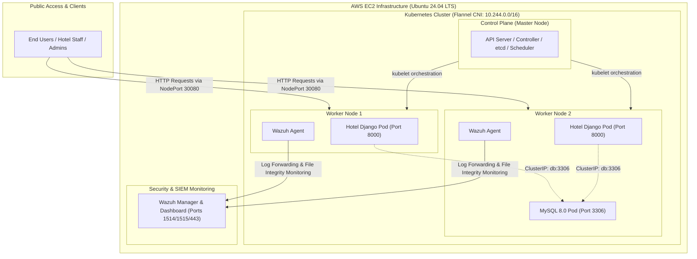

# Scalable, High-Availability & Secure Cloud Infrastructure for Web Applications
### Powered by Docker, Kubernetes, AWS EC2 & Wazuh SIEM

[](https://aws.amazon.com/)
[](https://kubernetes.io/)
[](https://www.docker.com/)
[](https://www.djangoproject.com/)
[](https://www.mysql.com/)
[](https://wazuh.com/)
[](https://ubuntu.com/)

---

## 📌 Overview

This project was developed as an end-of-year engineering project (**Projet de Fin d'Année - 4IIR**, Cybersecurity & Network Infrastructure track at **EMSI**). 

The primary objective is to modernize a traditional, single-point-of-failure hotel management web application (**Hotel Django**) by deploying it onto a scalable, highly available, resilient, and securely monitored multi-node Cloud infrastructure on **Amazon Web Services (AWS)** using **Docker**, **Kubernetes (kubeadm)**, and **Wazuh SIEM**.

---

## 🏗️ System Architecture



---

## 🚀 Key Features

* **Containerized Workload:** Application encapsulated in standardized Docker containers for seamless portability and reproducibility.
* **Multi-Node Kubernetes Cluster:** Orchestrated via `kubeadm` with 1 Control Plane Master and 2 Worker Nodes.
* **Cluster Networking:** Overlay pod network managed via **Flannel CNI** (`10.244.0.0/16`).
* **High Availability & Self-Healing:** Automatic container restarts, replica management, and failure recovery.
* **External Access:** Exposed via Kubernetes **NodePort Service** on port `30080`.
* **Database Persistence:** Managed MySQL 8.0 deployed within Kubernetes, decoupled and reachable via ClusterIP.
* **Centralized SIEM & Threat Detection:** Full integration with **Wazuh Manager & Agents** across worker nodes for real-time log analysis, intrusion detection, rootkit detection, and file integrity monitoring (FIM).

---

## 🛠️ Tech Stack & Tools

| Component | Technology | Description |
| :--- | :--- | :--- |
| **Cloud Provider** | AWS EC2 | Virtual machines hosting Master, Workers, and SIEM |
| **Operating System** | Ubuntu Server 24.04 LTS | Base OS across all instances |
| **Container Engine** | Docker & containerd | Container build and runtime execution |
| **Orchestrator** | Kubernetes (`kubeadm`, `kubectl`, `kubelet`) | Cluster scheduling, self-healing, deployment |
| **Overlay Network** | Flannel | Container Network Interface (CNI) |
| **Backend Framework** | Python / Django | Hotel management business logic, ORM, and REST endpoints |
| **Database** | MySQL 8.0 | Relational storage for reservations, rooms, users, and billing |
| **Security & SIEM** | Wazuh | Host-based IDS (HIDS), centralized log ingestion & dashboard |

---

## 📂 Repository Structure

```text
├── k8s/
│   ├── django-deployment.yaml     # Kubernetes Deployment for Django app
│   ├── django-service.yaml        # NodePort Service exposing Django (Port 30080)
│   ├── mysql-deployment.yaml      # Deployment for MySQL Database
│   ├── mysql-service.yaml         # ClusterIP Service for internal DB access
│   └── kube-flannel.yml           # Flannel CNI Network Manifest
├── docker/
│   ├── Dockerfile                 # Multi-stage/Optimized Dockerfile for Django
│   ├── docker-compose.yml         # Local development environment specification
│   └── .dockerignore              # Exclusions for Docker build context
├── docs/
│   ├── architecture-diagram.png   # High-level architecture visualization
│   └── screenshots/               # Application UI and Wazuh dashboard previews
├── .env.example                   # Sanitized template for environment variables
├── .gitignore                     # Git tracking exclusions
└── README.md                      # Project documentation
```

---

## ⚙️ Installation & Deployment Guide

### 1. Local Testing with Docker Compose

To test the application and database locally before deploying to the cluster:

```bash
# Clone the repository
git clone https://github.com/<your-username>/<your-repo-name>.git
cd <your-repo-name>

# Configure environment variables
cp .env.example .env

# Build and start services
docker compose up -d --build

# Run migrations and create superuser
docker compose exec web python manage.py migrate
docker compose exec web python manage.py createsuperuser

# Access the application at http://localhost:8000
```

---

### 2. Kubernetes Cluster Deployment

#### A. Initialize Control Plane (Master Node)
```bash
sudo kubeadm init --pod-network-cidr=10.244.0.0/16

# Configure local kubeconfig
mkdir -p $HOME/.kube
sudo cp -i /etc/kubernetes/admin.conf $HOME/.kube/config
sudo chown $(id -u):$(id -g) $HOME/.kube/config

# Deploy Flannel CNI
kubectl apply -f https://raw.githubusercontent.com/flannel-io/flannel/master/Documentation/kube-flannel.yml
```

#### B. Join Worker Nodes
Run the join command generated during `kubeadm init` on each worker node:
```bash
sudo kubeadm join <MASTER_PRIVATE_IP>:6443 --token <TOKEN> --discovery-token-ca-cert-hash sha256:<HASH>
```

Verify nodes status:
```bash
kubectl get nodes
```

#### C. Deploy Application Stack
```bash
# Deploy Database
kubectl apply -f k8s/mysql-deployment.yaml
kubectl apply -f k8s/mysql-service.yaml

# Deploy Django Web Application
kubectl apply -f k8s/django-deployment.yaml
kubectl apply -f k8s/django-service.yaml

# Verify Pods and Services
kubectl get pods -o wide
kubectl get svc
```

Access the application via:
```text
http://<WORKER_PUBLIC_IP>:30080
```

---

### 3. Wazuh SIEM Agent Setup

On each Worker Node:
```bash
# Install Wazuh Agent
sudo apt-get update && sudo apt-get install -y wazuh-agent

# Register agent with the Wazuh Manager
sudo WAZUH_MANAGER='<WAZUH_MANAGER_IP>' /var/ossec/bin/agent-auth -m <WAZUH_MANAGER_IP>

# Enable and start the agent service
sudo systemctl daemon-reload
sudo systemctl enable wazuh-agent
sudo systemctl start wazuh-agent
```

Verify agent connectivity on the Wazuh Dashboard at `https://<WAZUH_MANAGER_IP>`.

---

## 🛡️ Technical Challenges & Mitigations

During the deployment lifecycle, several real-world operational challenges were resolved:

| Challenge / Error | Root Cause | Solution Implemented |
| :--- | :--- | :--- |
| **Disk Exhaustion on Master** | Default EC2 root volume saturation caused by container images & package cache. | Resized AWS EBS volume and ran automated cache pruning (`docker system prune -a`). |
| **`CrashLoopBackOff` on Django** | Django pod started before the MySQL service became ready to accept connections. | Added database readiness verification and aligned container environment variables. |
| **`ErrImageNeverPull`** | Local Docker images were not present on worker nodes in the absence of a shared registry. | Loaded container images onto workers using `docker save / load` and configured `imagePullPolicy: IfNotPresent`. |
| **Django `DisallowedHost`** | NodePort accesses originated from dynamic AWS public IPs not included in Django settings. | Updated `ALLOWED_HOSTS` dynamically via environment variables. |
| **Wazuh Agent Communication** | AWS Security Groups blocked inbound agent registration and log shipping ports. | Configured security group ingress rules for ports `1514/TCP` (events) and `1515/TCP` (registration). |

---

## 📈 Roadmap & Future Improvements

- [x] **v1.0**: Core containerization, multi-node Kubernetes orchestration, and Wazuh agent log shipping.
- [ ] **v2.0**: Integration of **NGINX Ingress Controller** with automated **Cert-Manager** for TLS/HTTPS termination.
- [ ] **v3.0**: Automated **CI/CD pipelines** (GitHub Actions) with push-to-deploy to a secure private container registry (e.g., AWS ECR).
- [ ] **v4.0**: Advanced telemetry with **Prometheus** metrics scraping and **Grafana** visualization dashboards.

---

## 👥 Authors & Academic Context

* **Houssam Niri** - 4IIR Engineering Student, EMSI
* **Othmane Aitmbarek** - 4IIR Engineering Student, EMSI
* **Academic Supervisor:** Mr. Chiba Zouhair
* **Institution:** École Marocaine des Sciences de l'Ingénieur (EMSI)
* **Academic Year:** 2025 – 2026

---

## 📜 License

This project is open-source and available under the [MIT License](LICENSE).
